# 🍔 Food Dash - Premium Full-Stack Food Delivery App

A premium, modern, and highly interactive Full-Stack Food Delivery Web Application. Built with **Next.js 16 (App Router)** for a blazing-fast, localized client interface, and **Express / MongoDB** for a robust, secure administrative backend.

---

## 📸 App Screenshots & User Experience

### 🌐 Public & Shopping Experience
| 🏠 Landing Page & Sorting | 🍕 Dynamic Category Filters |
|:---:|:---:|
| 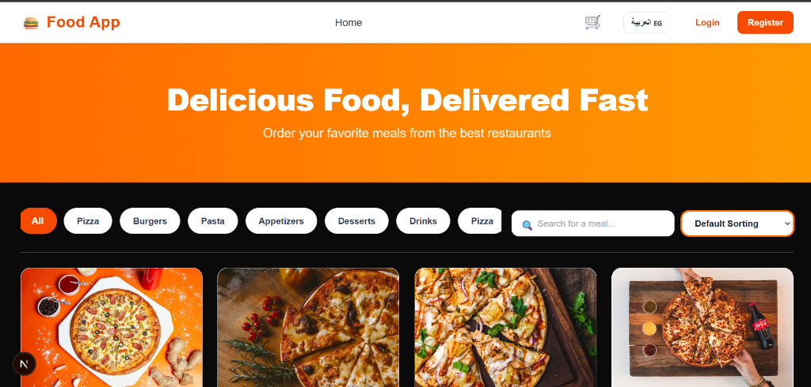 | 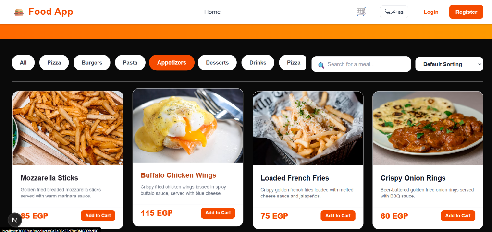 |

| 🔍 Price sorting dropdown | 🗣️ Full Arabic RTL Layout |
|:---:|:---:|
| 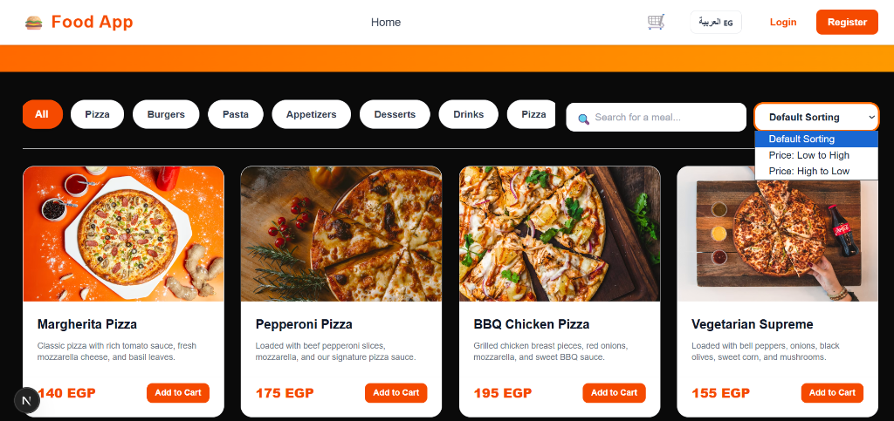 | 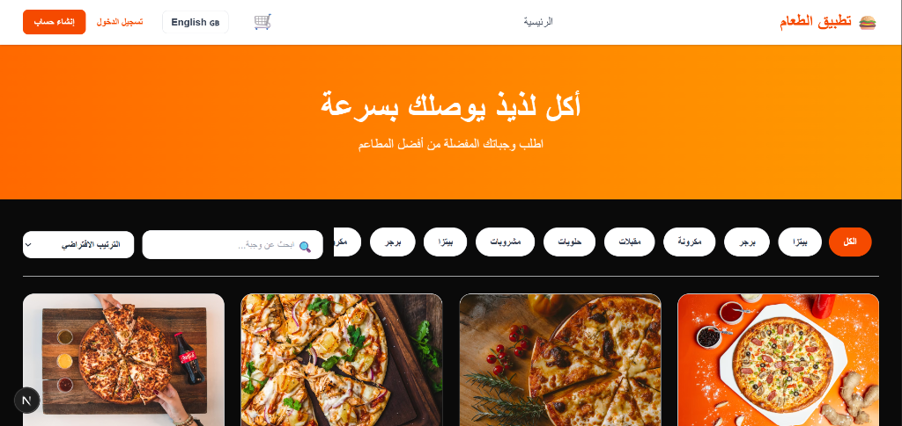 |

---

### 🛒 Authentication & Cart Lifecycle
| 🔐 Secure Registration | 🔑 Modern Login Screen |
|:---:|:---:|
| 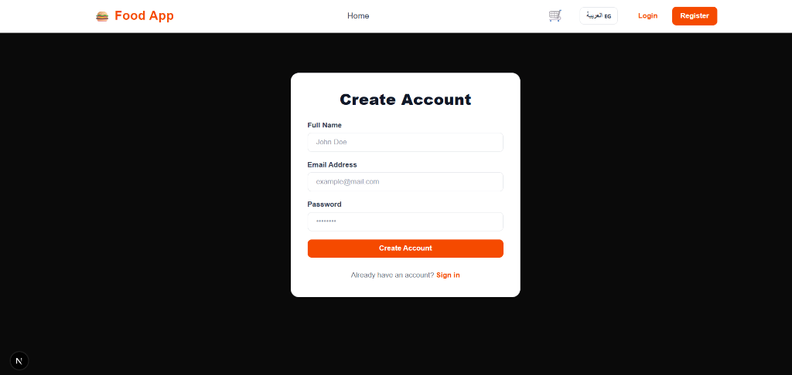 | 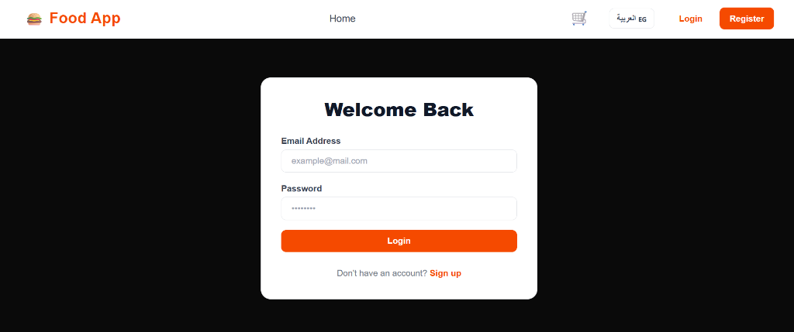 |

| 🛍️ Active Cart | 📭 Empty Cart State |
|:---:|:---:|
| 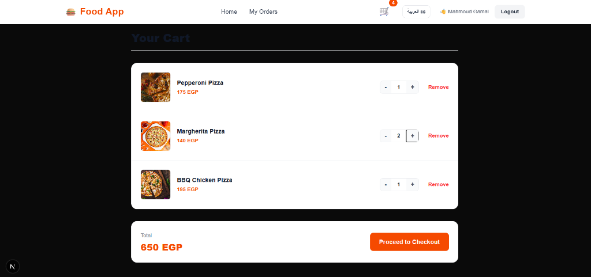 | 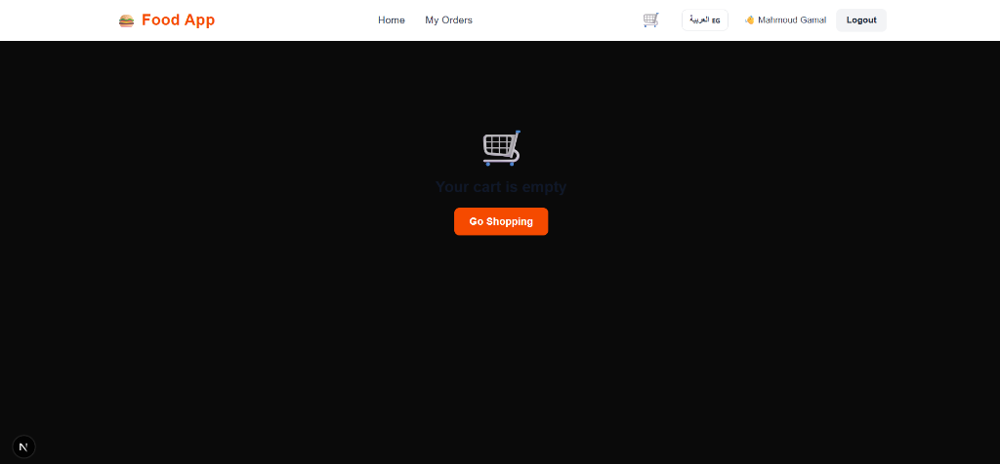 |

---

### 📦 Order Management & Admin Dashboard
| 🚚 User Orders & Localized Time | ⚙️ Admin Dashboard Header |
|:---:|:---:|
| 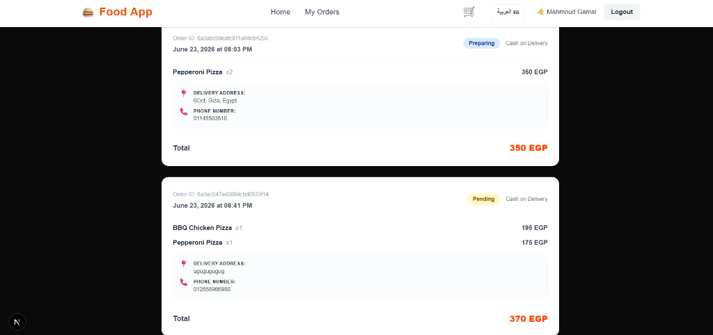 | 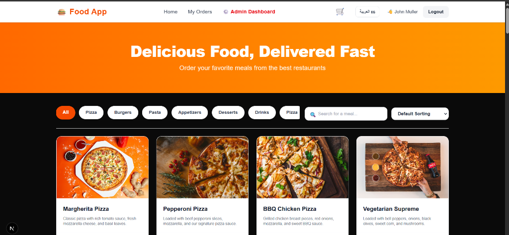 |

---

### 👑 Administrative Operations (`/admin`)
| 🍕 Products Management | 📁 Categories Management | 🛵 Orders Live Status Updates |
|:---:|:---:|:---:|
| 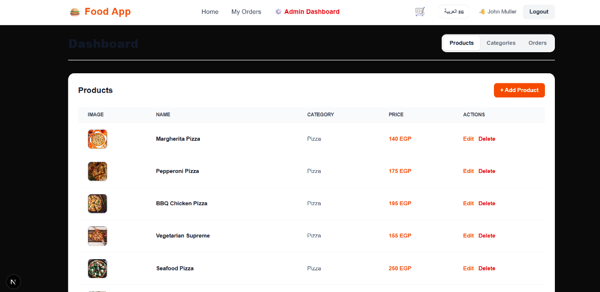 | 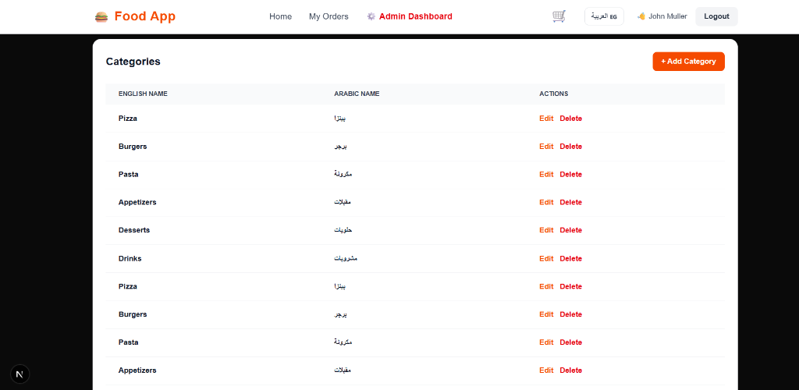 | 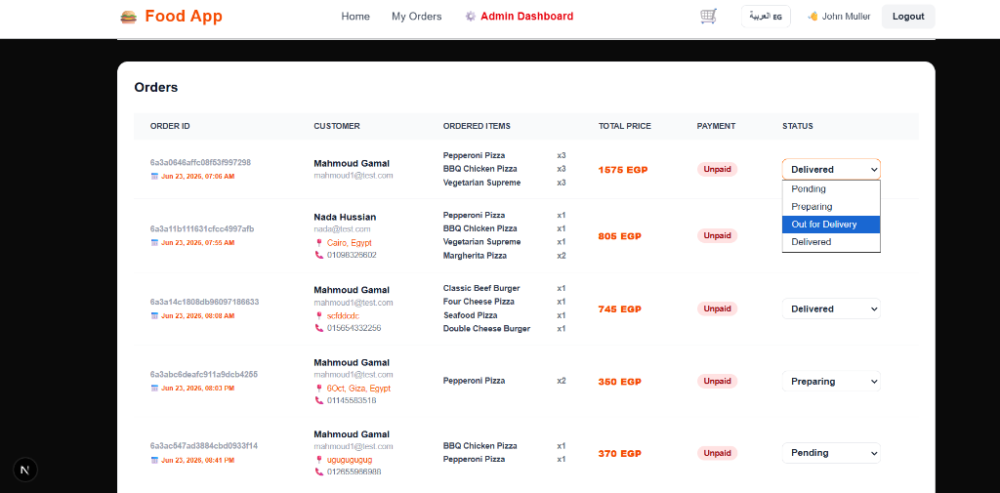 |

---

## 🚀 Key Features

### 👤 Customer Experience
*   **🌐 Fully Bilingual (i18n)**: Seamless English & Arabic support with automatic LTR/RTL layout switching.
*   **🔍 Product Search**: Live product search dynamically matching localized descriptions and titles.
*   **⚡ Price Sorting**: Sort meals dynamically from lowest to highest or highest to lowest.
*   **🛒 Persistent Cart**: State-managed shopping cart powered by **Zustand** with local storage scoping per user.
*   **📍 Delivery Address & Phone Fields**: Structured fields during checkout to specify shipping and contact details.
*   **💳 Dual Payment Options**: Cash on Delivery (COD) or Online Payment methods.
*   **📦 Real-time Order Tracking**: Interactive user dashboard to view previous orders with localized precise placement times.
*   **⚡ Micro-Animations & Hover Effects**: Smooth component lifts, zoom transitions, and interactive scale compressions.

### 👑 Administrative Dashboard (`/admin`)
*   **📊 Comprehensive Overview**: Manage products, categories, and orders in one central panel.
*   **📁 Category Management**: Full CRUD operations to structure food categories.
*   **🍕 Product Management**: CRUD modals to add, update, or remove dishes, prices, descriptions, and images.
*   **🛵 Live Order Management**: Manage pending requests, update statuses (Pending, Preparing, Out for Delivery, Delivered), and view customer details, delivery addresses, and phone numbers.
*   **🔒 Administrative Route Protection**: Strict role checks that block unauthorized guests or standard users.

---

## 🛠️ Tech Stack

### Frontend
*   **Core**: React 19, Next.js 16 (App Router), TypeScript
*   **State Management**: Zustand (with Persist middleware)
*   **Styling**: Tailwind CSS 4
*   **Localization**: next-intl (Bilingual English / Arabic)

### Backend & Database
*   **Core**: Node.js, Express, TypeScript
*   **Database**: MongoDB (via Mongoose ODM)
*   **Authentication**: JSON Web Tokens (JWT) with HTTP-only cookies

---

## 📂 Project Structure

```
Food App/
├── backend/                  # Express & Mongoose API Server
│   ├── src/
│   │   ├── config/           # Database configuration
│   │   ├── controllers/      # Request handlers (Auth, Product, Category, Order)
│   │   ├── middleware/       # Auth and Role guards
│   │   ├── models/           # Mongoose schemas (User, Product, Category, Order)
│   │   ├── routes/           # Express routers
│   │   ├── types/            # TypeScript interfaces
│   │   └── server.ts         # App entry point
│   ├── package.json
│   └── tsconfig.json
│
└── frontend/                 # Next.js 16 Client Web App
    ├── messages/             # Localized i18n JSON translation files (en.json, ar.json)
    ├── src/
    │   ├── app/[locale]/     # Next.js App Router localized page components
    │   ├── components/       # Reusable React components (Auth, Cart, Checkout, Admin)
    │   ├── constants/        # API endpoints and configuration constants
    │   ├── hooks/            # Custom hooks wrapping business logic
    │   ├── services/         # Axios API service instances
    │   └── store/            # Zustand global state stores (Cart, Auth)
    ├── tailwind.config.ts
    └── package.json
```

---

## 🔧 Installation & Setup

### Prerequisites
- Node.js (v18+)
- MongoDB (Local instance or MongoDB Atlas Cluster)

### 1. Backend Configuration
1. Navigate to the backend folder:
   ```bash
   cd backend
   ```
2. Install dependencies:
   ```bash
   npm install
   ```
3. Create a `.env` file in the `backend/` directory:
   ```env
   PORT=5000
   MONGO_URI=your_mongodb_connection_string
   JWT_KEY=your_secure_jwt_secret_key
   ```
4. Run the development server:
   ```bash
   npm run dev
   ```

### 2. Frontend Configuration
1. Navigate to the frontend folder:
   ```bash
   cd ../frontend
   ```
2. Install dependencies:
   ```bash
   npm install
   ```
3. Run the Next.js development server:
   ```bash
   npm run dev
   ```
4. Open [http://localhost:3000](http://localhost:3000) in your browser.

---

## 🔌 API Endpoints Summary

### Authentication `/auth`
*   `POST /auth/register` - Create a new account
*   `POST /auth/login` - Authenticate user & set cookie
*   `POST /auth/logout` - Clear token session cookie

### Products `/products`
*   `GET /products` - Fetch all products
*   `GET /products/:id` - Fetch single product details
*   `GET /products/category/:categoryId` - Get products under a category
*   `POST /products` - Create new product (Admin)
*   `PUT /products/:id` - Edit product details (Admin)
*   `DELETE /products/:id` - Delete a product (Admin)

### Categories `/categories`
*   `GET /categories` - Fetch all categories
*   `POST /categories` - Create new category (Admin)
*   `PUT /categories/:id` - Edit category (Admin)
*   `DELETE /categories/:id` - Delete category (Admin)

### Orders `/orders`
*   `POST /orders` - Create order (requires `address` and `phone`)
*   `GET /orders/myorders` - Fetch logged-in user's orders
*   `GET /orders/:id` - Fetch single order details
*   `GET /orders` - Fetch all system orders (Admin)
*   `PUT /orders/:id` - Update status of an order (Admin)

---

## 📄 License
This project is licensed under the ISC License.
